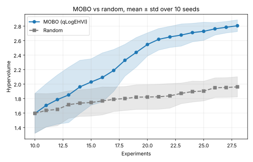
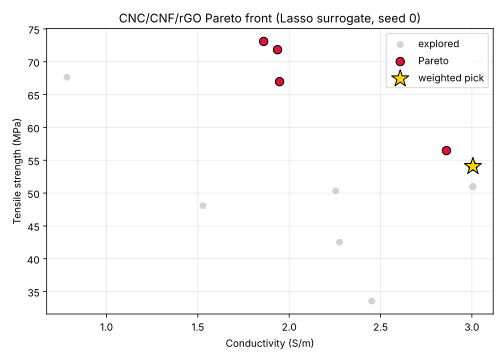

# Multi-Objective Bayesian Optimization for Nanocomposite Materials

Adaptive experimental design for CNC/CNF/rGO nanocomposite films using
Multi-Objective Bayesian Optimization (MOBO) with the qLogEHVI acquisition
function.

## Overview

This project implements the MOBO loop of Liu & Kalinin (2025)
(arXiv:2504.06525) and applies it to the synthesis of cellulose nanocrystal
(CNC) / cellulose nanofiber (CNF) / reduced graphene oxide (rGO) films.

The optimizer simultaneously maximizes:
- Electrical conductivity (S/m)
- Tensile strength (MPa)

over a 7-dimensional synthesis space: CNC ratio, CNF ratio, rGO loading, acid
concentration, pH, temperature and reaction time.

## Results

### Benchmark: MOBO vs random search

`run_experiment.py` on the synthetic 3-objective benchmark in `objectives.py`.
Both arms start from the same evaluated 10-point Sobol design and get the same
budget of 28 evaluations, so each seed is a paired comparison. 10 seeds.

| Method | Final hypervolume (mean ± std) | Seeds ahead |
|---|:---:|:---:|
| MOBO (qLogEHVI) | **2.805 ± 0.081** | 10 / 10 |
| Random search | 1.961 ± 0.139 | 0 / 10 |

MOBO reaches random search's final mean hypervolume after **14 evaluations
instead of 28** (mean curve; per seed 10–18), i.e. with half the experiments.
The paired gain at the end of the budget is 0.84 ± 0.12.

Every curve and the statistics above are in
[`results/summary.json`](results/summary.json).

### CNC/CNF/rGO

`run_cnc_cnf_rgo.py`: 5 initial formulations plus 10 MOBO proposals, against
random search with the same budget, 5 seeds.

| Method | Final hypervolume (mean ± std) | Seeds ahead |
|---|:---:|:---:|
| MOBO (qLogEHVI) | **133.6 ± 1.4** | 5 / 5 |
| Random search | 89.6 ± 3.5 | 0 / 5 |

The objective is a Lasso surrogate fitted to the five L-ascorbic-acid-reduced
formulations in [`data/cnc_cnf_rgo_data.csv`](data/cnc_cnf_rgo_data.csv). Its
coefficients carry the trade-off the optimizer has to navigate: rGO loading
raises conductivity (+0.27 per standard deviation) and lowers tensile strength
(−4.5), while CNF and CNC raise strength. The Pareto front therefore runs
along rGO loading, and the conductivity-weighted (2:1) pick sits at the top of
the rGO range with CNF and CNC at their upper bounds.

The surrogate is linear in the inputs, so its optimum lies on the boundary of
the design box and its predictions there (3.0 S/m, 54 MPa) extrapolate beyond
the range in the table (0.9–2.1 S/m, 35–52 MPa). That boundary formulation is
exactly the next experiment to run: each measurement returned to the loop
replaces surrogate extrapolation with data. A measured objective has the same
call signature as `LassoSurrogateObjective`, so it drops into `run_mobo`
unchanged.

Details in [`results_cnc/summary.json`](results_cnc/summary.json).

## Method

    Initial Sobol design
            |
    Independent GP per objective (SingleTaskGP, standardized outcomes)
            |
    qLogExpectedHypervolumeImprovement over a box decomposition
    of the non-dominated region
            |
    Evaluate proposal, update Pareto front and hypervolume
            |
    Weighted pick from the Pareto front (human-in-the-loop preference)

qLogEHVI integrates the hypervolume *improvement* over the region not yet
dominated by the observed front, so it takes a decomposition of the
non-dominated region (`FastNondominatedPartitioning`). The dominated-region
decomposition (`DominatedPartitioning`) is what computes the hypervolume
itself. `tests/test_mobo.py` checks the acquisition against hand-computed
improvements on a two-point front: 3.25 for a point dominating the front, 0 for
a point already dominated.

## Project structure

    materials-mobo/
    |-- mobo_core.py            MOBO loop: GPs, qLogEHVI, hypervolume, random baseline, preference pick
    |-- objectives.py           Synthetic 3-objective benchmark (SPM imaging controls)
    |-- cnc_cnf_rgo.py          CNC/CNF/rGO design space and Lasso surrogate objective
    |-- run_experiment.py       MOBO vs random on the benchmark
    |-- run_cnc_cnf_rgo.py      MOBO vs random on CNC/CNF/rGO, weighted pick
    |-- data/
    |   |-- cnc_cnf_rgo_data.csv
    |-- results/                Benchmark curves, summary.json, hypervolume plot
    |-- results_cnc/            CNC/CNF/rGO summary.json and Pareto plot
    |-- tests/test_mobo.py

## Quick start

    pip install -r requirements.txt
    python -m pytest -q                       # ~5 s on CPU
    python run_experiment.py --seeds 10       # ~6 min on 2 CPU cores
    python run_cnc_cnf_rgo.py --seeds 5       # ~1 min

## Tested with

Python 3.13, PyTorch 2.14, BoTorch 0.18.1, GPyTorch 1.15.2, scikit-learn 1.9,
pandas 3.0, matplotlib 3.11; CPU only.

## Reference

Liu, Z. & Kalinin, S.V. (2025). Adaptive Experiment Design with Multi-Objective
Bayesian Optimization. arXiv:2504.06525

## Author

Ghazaleh Ramezani — Materials Science & Machine Learning, Concordia University
